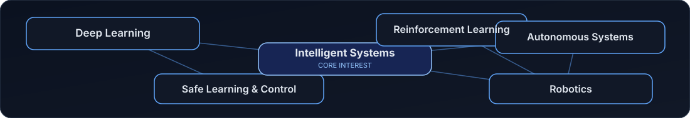

### AI Research · Intelligent Systems · Robotics

**I study and build learning-based systems where intelligence meets real-world constraints.**

---

## About

I'm **Hooman Soleymani**, an MSc student in **Computer Engineering (AI & Robotics)**, focused on **deep learning, reinforcement learning, and intelligent autonomous systems**.

My approach combines implementation with research-oriented thinking: define the problem, state assumptions, build reproducible experiments, compare meaningful baselines, and report only what the evidence supports.

> **Research principle:** clear assumptions · honest evaluation · reproducible code

## Research interests

  

- **Deep Reinforcement Learning** — policy learning, continuous control, and robust evaluation.
- **Intelligent & Autonomous Systems** — decision-making, learning-based control, and autonomy.
- **Safe Learning and Control** — constraint-aware learning, safety filters, and reliable behavior.
- **Applied Deep Learning** — building and evaluating models for clearly defined tasks.

## Current research

### Reinforcement learning for nonlinear thermal systems

My MSc thesis investigates a reinforcement-learning framework for improving energy consumption in a simulated nonlinear industrial thermal system.

**Technical direction**
- Soft Actor-Critic (SAC) as the primary reinforcement-learning algorithm.
- A physics-informed reward that considers energy use and setpoint tracking.
- Investigation of a Control Barrier Function / Quadratic Programming (CBF-QP) safety layer.
- Comparison with conventional control baselines, including PID and Model Predictive Control (MPC).
- Evaluation under parameter variation and changing system conditions.

*This research is ongoing. Performance claims and numerical results will be added only after they are measured and documented.*

## Technical toolkit

| Area | Tools / topics |
|---|---|
| Programming | Python |
| Deep learning | PyTorch |
| Reinforcement learning | Stable-Baselines3; reinforcement-learning environments |
| Research workflow | Experimental design, baseline comparison, ablations, reproducibility |
| Backend & APIs | FastAPI, Django |
| App development | Flutter |
| Engineering workflow | Git, GitHub, Linux |

*This list reflects tools and technologies I work with; it does not imply expert-level proficiency in every item.*

## Selected work

### [thermal-sim-v1](https://github.com/Hooman-Jericho/thermal-sim-v1) — Nonlinear thermal-system simulation

A developing research codebase for a simulated nonlinear thermal system and reinforcement-learning experiments.

- **Focus:** simulation, control, reward design, and evaluation.
- **Methods under study:** SAC, safety filtering, and PID/MPC baselines.
- **Status:** in development.

[Explore all repositories →](https://github.com/Hooman-Jericho?tab=repositories)

> Additional projects will be featured here as their documentation, experiments, and reproducible results become ready.

## GitHub activity

Third-party cards may be rate-limited or temporarily unavailable. GitHub activity metrics are not a measure of research quality.

## Contribution graph

  <picture>
    <source media="(prefers-color-scheme: dark)" srcset="https://raw.githubusercontent.com/Hooman-Jericho/Hooman-Jericho/output/github-contribution-grid-snake-dark.svg"/>
    <source media="(prefers-color-scheme: light)" srcset="https://raw.githubusercontent.com/Hooman-Jericho/Hooman-Jericho/output/github-contribution-grid-snake.svg"/>
    
  </picture>

## Connect

---

  
  Build carefully · Measure honestly · Learn continuously

