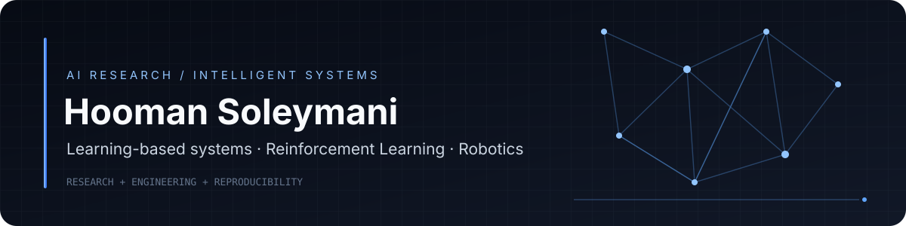

### AI Developer · Machine Learning · Deep Learning · Reinforcement Learning

**I build learning-based systems that work outside the notebook — and I measure them honestly.**

---

## About

I'm **Hooman**, an MSc student in **Computer Engineering (AI & Robotics)**. My core areas are **Machine Learning**, **Deep Learning** (mostly **Computer Vision**) and **Reinforcement Learning**.

I'm not only a researcher: I also work as a freelance developer and have shipped real web products for real clients. That means I care about the part many ML projects skip — turning a model into something people can actually run, use and trust.

> **How I work:** define the problem → build a baseline → measure → only then claim.

## What I work on

| Area | What I do |
|---|---|
| **Computer Vision** | Deep-learning models for visual tasks: training, evaluation, error analysis |
| **Reinforcement Learning** | Continuous control, reward design, safety-constrained learning |
| **Machine Learning** | Clean pipelines, honest baselines, reproducible experiments |
| **AI Engineering** | Wrapping models in APIs and apps (FastAPI, React), LLM/RAG experiments |

## Current research

### Safe reinforcement learning for nonlinear thermal systems *(MSc thesis)*

Physics-informed, safety-constrained RL to reduce energy consumption in a simulated nonlinear industrial thermal system.

- **Algorithm:** Soft Actor-Critic (SAC)
- **Reward:** physics-informed (energy use + setpoint tracking)
- **Safety:** Control Barrier Function / QP safety layer (under investigation)
- **Baselines:** PID and Model Predictive Control
- **Evaluation:** parameter variation and changing conditions

📦 Simulation foundation: [`thermal-sim-v1`](https://github.com/Hooman-Jericho/thermal-sim-v1) — object-oriented thermal simulator with analytical validation and tests.

*Work in progress. Results will be published here only after they are measured and reproducible.*

## Built & shipped

<!-- TODO: add links/screenshots/GIFs here once each project has a public repo or demo. -->

- **Menuvia / Menofy** — QR-based AI-assisted menu platform for restaurants and cafes *(SaaS, in development)*
- **Persian live-dubbing app** — Android app that dubs video audio into Persian in near real time using a live speech model
- **Client web projects** — production websites and admin panels (React + FastAPI) built for businesses in Iran

## Tech stack

## Currently building

- 🧪 A reproducible RL benchmark for the thermal-system thesis (SAC vs PID vs MPC)
- 🔎 Evaluation-first LLM / RAG projects (retrieval metrics, faithfulness, regression tests)
- 🖼️ Computer-vision experiments with proper baselines and error analysis

## Let's talk

I'm looking for an **AI Developer** role where ML, deep learning (especially vision) and RL are applied to real products.

---

  
  Build carefully · Measure honestly · Learn continuously

